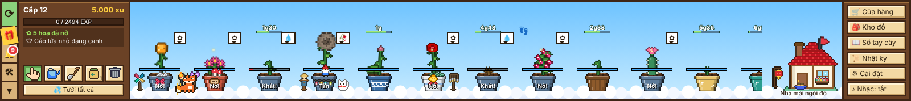

# 🌱 Vườn Pixel

Một vườn cây pixel nằm gọn trong **thanh ngang ở cạnh màn hình Windows** (trên taskbar). Thanh có thể thu gọn
thành một tab nhỏ. Bạn gieo hạt, tưới cây, chờ hoa nở, thu hoạch lấy **xu + EXP**, rồi mua chậu đẹp và đồ trang trí.

Vườn **chỉ chạy trong giờ làm** (mặc định T2–T6, 08:00–17:00, nghỉ trưa 12:00–13:00): tối và cuối tuần cây "ngủ",
không lớn và không khát → không lo cây chết khi về nhà.



## Tải về chơi trên Windows

1. Mở trang **[bản phát hành mới nhất](https://github.com/zizizi199/pixel-garden/releases/latest)**.
2. Ở mục **Assets**, tải file **`VuonPixel-<phiên bản>-Windows.zip`** (ví dụ `VuonPixel-0.2.0-Windows.zip`, khoảng 150 MB).
3. Giải nén toàn bộ rồi bấm **`Choi-Vuon-Pixel.cmd`**. Giữ các file trong cùng thư mục; không chạy trực tiếp bên trong ZIP.

Có thể kiểm tra file tải về bằng mã SHA-256 ghi trong trang phát hành (file `.sha256` đi kèm).
Admin bị tắt trong bản phát hành. Chế độ LAN mặc định tắt và chỉ mở khi bạn chủ động tạo phòng.

Bạn được tải và chơi bản phát hành. Mã nguồn được công khai để xem; hiện chưa cấp quyền sử dụng lại,
chỉnh sửa hoặc phân phối lại mã nguồn và hình ảnh.

## Chạy từ mã nguồn

Cần [Node.js](https://nodejs.org) 20 trở lên.

```bash
git clone https://github.com/zizizi199/pixel-garden.git
cd pixel-garden
npm install
npm start
```

Đóng gói ZIP có file khởi chạy (chạy trên Windows):

```bash
npm run share:win
```

### Phát hành bản mới lên GitHub

Mỗi lần sửa code xong, chạy **`scripts\publish-release.cmd`** (bấm đúp). Script sẽ:

1. Chạy `npm test` – lỗi thì dừng, không đẩy gì lên.
2. Hỏi phiên bản mới (Enter = tăng số cuối, ví dụ 0.2.0 → 0.2.1; gõ `giu` để ghi đè bản hiện tại).
3. Hiện danh sách file thay đổi, hỏi mô tả ngắn và xác nhận `y`.
4. Commit, đẩy nhánh `main` và tag `v<phiên bản>` → GitHub Actions (`.github/workflows/release-windows.yml`)
   tự đóng gói và tạo Release; khoảng 5–10 phút sau trang Releases có file ZIP và `.sha256`.
5. Tuỳ chọn: đóng gói ZIP ngay trên máy (`npm run share:win`, ra thư mục `dist`) để chơi thử.

Lệnh tạo portable EXE và bộ cài NSIS qua electron-builder:

```bash
npm run dist
```

Chạy test logic: `npm test`.
Nút Admin 🛠 chỉ hiện trên máy của người phát triển: chạy `scripts\tao-khoa-admin.cmd` một lần trên máy đó
(tạo khoá bí mật ở `%USERPROFILE%\.vuon-pixel-admin\` – không nằm trong repo – và ghi `adminPublicKey` vào
`package.json`), rồi phát hành bản mới. Máy khác, kể cả khi chép file khoá sang, không bật được Admin.

## Chơi cùng bạn (nhóm Supabase)

Cách chính: **nhóm chơi chung qua Supabase** – cài 1 lần theo [`supabase/README.md`](supabase/README.md).
Trong game mở **🌐 Bạn bè & chat › 🌱 Tạo nhóm mới**, gửi riêng **mã nhóm** `VP-…` cho đồng nghiệp; họ dán vào
**Vào nhóm**. Bấm **Thăm vườn** cạnh tên một người: thanh vườn hiện vườn của họ, bấm cây để **tưới hộ**, hoặc
**hái trộm hoa đang nở** khi chủ vắng mặt / đã tắt game. Chat nhóm được mã hoá bằng mã nhóm, lưu 7 ngày.

Khi `package.json` chưa có cấu hình `supabase`, game dùng cách cũ bên dưới.

### Cách cũ: phòng LAN / Internet

Mở **🌐 Bạn bè & chat** ở menu bên phải. Chủ phòng chọn một trong hai:

- **🌐 Mở phòng Internet** (mã mời `PG2|…`): chơi được dù mạng công ty chặn LAN hay khác mạng. Dữ liệu đi qua
  máy trung chuyển Cloudflare nhưng được mã hoá đầu-cuối, trạm không đọc được. Cần cài trạm 1 lần – xem
  [`relay/README.md`](relay/README.md) (bấm đúp `relay\deploy-relay.cmd`).
- **Mở phòng LAN** (mã mời `PG1|…`): chọn địa chỉ mạng nội bộ; chỉ dùng được trong cùng mạng.

Sau khi mở phòng, bấm **Tạo mã mời bạn**. Gửi mã đó riêng cho người muốn mời; người nhận dán vào ô **Vào phòng**.
Mã mời dùng để ghép cặp lần đầu trong 15 phút. Những lần sau có thể bấm **Kết nối lại phòng đã ghép cặp**.

Người mới vào sẽ ở mục **Người chơi khác**; bấm **Kết bạn** để chuyển sang **Bạn bè**. Trong phòng có
nút **Thăm vườn**, **Tưới hộ** và phòng
**Chat thế giới · phòng LAN**. Khi thu gọn vườn thành thanh nhỏ, app tự hiện **Vắng mặt** cho người trong
phòng và họ có thể hái hoa đang nở; mở vườn trở lại thì tự hiện **Đang chơi**. App phải còn chạy thì
lượt thăm mới được xử lý. Chủ phòng có thể bấm **Chặn** để thu hồi quyền vào phòng.

## Cảnh vườn

Vào **Cửa hàng › Cảnh vườn** để mua mô hình đặt cạnh nhà thú và phông nền phía sau chậu hoa; một số
món chỉ nhận từ **Vòng quay may mắn**. Mua một lần, đổi món đang dùng trong **Kho đồ › Cảnh vườn**.
Cả mô hình và phông nền đều được vẽ bằng code và có chuyển động.

Phòng chơi mặc định tắt, không tự tìm máy. Phòng LAN không dùng Internet; phòng Internet chỉ kết nối tới máy trung chuyển đã cấu hình. App chỉ gửi biệt danh, tin chat và
dữ liệu hiển thị vườn; không gửi lịch hoạt động, nhật ký, kho đồ, đường dẫn hoặc thông tin máy cho người chơi khác.
Từ bản 0.3, vườn của mỗi người (kể cả giờ vườn hoạt động trong Cài đặt) được lưu trên máy chủ Supabase của nhóm
để chống sửa chỉ số – chỉ máy chủ đọc được, người chơi khác không xem được. Game cần Internet để chơi.
Nội dung trao đổi được mã hoá bằng mã mời riêng; địa chỉ IP và cổng kết nối vẫn hiện với người được mời
và hệ thống mạng. Windows Firewall có thể cần cho phép app nhận kết nối trên mạng nội bộ.

**Chế độ phát triển** (chạy bằng `npm start`/`yarn start`): sửa file trong `src/renderer` thì giao diện tự tải lại,
sửa `src/core` hoặc `src/main` thì app tự lưu và khởi động lại – không cần chạy lại lệnh. Có thêm nút 🛠 **Admin**
ở cột trái (thêm xu, lên cấp, tua nhanh thời gian, cho cây nở, làm cây khát, giả lập hái trộm…); bản đóng gói `.exe` không có nút này.

## Cách chơi

| Thao tác | Cách làm |
|---|---|
| Gieo hạt | Bấm vào ô chậu trống → chọn hạt |
| Tưới / thu hoạch | Công cụ 👆 (tay): bấm cây là tự làm việc cần nhất – hoa nở thì thu hoạch, đất khô thì tưới |
| Công cụ khác | bình tưới · xẻng (thu hoạch) · phân bón · thùng rác (nhổ cây, bấm 2 lần). Phím tắt 1–5 |
| Xem chi tiết cây | Chuột phải vào cây |
| Thu gọn / mở thanh | Nút ▾ bên trái, phím **Esc**, phím tắt toàn cục **Ctrl+Alt+G**, hoặc bấm icon ở khay hệ thống |
| Mở ô chậu mới | Ô có 🔒 ở cuối vườn (bấm 2 lần) hoặc Cửa hàng → Vật phẩm |
| Đặt chậu / đồ trang trí | Kho đồ (chọn ô trong vườn trước khi đặt chậu) |
| Pet | Cửa hàng → Pet. Mỗi vườn 1 pet đi dạo dọc vườn; bấm vào pet để xem trạng thái |
| Hôm nay bắt đầu muộn/sớm | Nút **⟳** trên bảng trạng thái (bấm 2 lần): vườn tính thời gian từ lúc bấm |
| Nhạc | Nút **♪ Nhạc** (mặc định tắt); âm lượng, âm thanh tương tác trong Cài đặt. Nhạc và hiệu ứng tự tạo bằng Web Audio, không dùng file có bản quyền |

**Luật chính**

- 25 loài hoa, mỗi loài có thời gian nở riêng (dựa theo độ nhanh chậm ngoài đời, rút gọn còn 5–90 phút: hoa đầu tiên 5–10 phút, hoa càng hiếm nở càng lâu).
- Nước cạn dần theo từng loài. Dưới 25% cây **khát** (lớn chậm một nửa); cạn nước khoảng 5 giờ làm thì cây **chết**.
  Nếu app tắt/máy ngủ (nghỉ phép, họp cả ngày) thì cây chỉ yếu đi, không chết.
- Một số hoa chỉ nở trong khung giờ: **mười giờ** 10:00–15:00, **sen** 08:00–11:00, **quỳnh** 16:00–17:00 (hết khung là khép/tàn).
- Hoa nở để lâu sẽ **tàn** → thu hoạch chỉ còn 40% giá trị.
- Cây lâu năm (sen, hồng, hoa giấy, quỳnh, lan) ra hoa lại nhiều lần rồi mới già.
- **Giống cây & chậu**: mỗi giống/loại chậu phải **mở khoá 1 lần** (đủ cấp + trả xu), sau đó mua theo **số lượng**:
  1 hạt gieo được 1 lần, 1 chậu dùng cho 1 ô. Mười giờ và vạn thọ mở sẵn (tặng 2 hạt mỗi loại), chậu nhựa miễn phí.
- **Mở thêm ô chậu** cần đủ cấp (ô 5: cấp 2, ô 6: cấp 3 … ô 12: cấp 12) và xu.
- **Trang trí theo từng chậu**: mỗi chậu có 4 chỗ (mặt đất, mặt chậu, cạnh trái, cạnh phải); mỗi món buff riêng cho chậu đó
  (giữ ẩm, lớn nhanh, +tiền, +EXP, chặn hái trộm). Mua ở Cửa hàng › Trang trí, đặt ở Kho đồ › Trang trí (chọn chậu trước).
- **Nhà thú**: có pet là nhà thú xuất hiện ở góc phải vườn; pet về nhà ngủ sau khi chặn trộm. Nâng cấp 4 cấp
  (Hộp các-tông → Nhà gỗ → Nhà mái ngói đỏ → Lâu đài mini) cho đẹp hơn và pet ngủ ít hơn (30 → 25 → 20 → 15 phút);
  4 chỗ trang trí nhà (mái, cửa sổ, bên cạnh, trước cửa).
- **Pet biết nói**: thỉnh thoảng pet nói câu vui, nhắc việc trong vườn, thông tin nhẹ trong ngày (thứ mấy, ngày lễ sắp tới, mùa hoa) hoặc mẩu kiến thức về hoa; bấm vào pet để nghe nói. Chỉnh trong Cài đặt (tắt / ít nói / vừa / lắm mồm).
- **Bậc độ hiếm**: cây, chậu, trang trí, pet chia 7 bậc Common → Uncommon → Rare → Epic → Legendary → Mythic → Secret.
- **Vòng quay may mắn 🎡**: mỗi bậc (Common → Secret) có vật phẩm độc quyền (hoa, chậu, trang trí, pet) chỉ mở khoá khi quay trúng;
  trúng rồi thì mua bình thường, không mất phí mở khoá. Bậc càng cao càng khó trúng; có bảo hiểm sau một số lượt.
  1 lượt miễn phí/ngày, 300 xu/lượt, 2.700 xu/10 lượt.
- **Quà hằng ngày 🎁** (1 lần/ngày): 72% ra 1–3 hạt giống, 27% ra 1 chậu (chỉ đồ đã mở khoá, đồ rẻ ra nhiều hơn),
  1% ra 1 pet loại Thường mà bạn chưa có.
- **Pet** (không yêu cầu cấp, đủ xu là mua; 22 loài, 300 → 30.000 xu, 4 hạng Thường/Hiếm/Quý/Huyền thoại; pet Huyền thoại dựng từ pet thường + đổi màu + phụ kiện pixel): pet nào cũng chặn chắc chắn 1 lần hái trộm,
  sau đó ngủ 💤 30 phút (thời gian thực) rồi tỉnh canh tiếp. Pet đắt hơn chỉ đẹp/cầu kì hơn.
- Chậu và đồ trang trí cho hiệu ứng: giữ ẩm lâu hơn, +% tiền, +% EXP, lớn nhanh hơn, chống trộm (cho chế độ LAN).

Thanh vườn chỉ hiện thông tin trong game (hoa sắp nở, trạng thái pet); thời gian hoạt động của vườn là thông tin riêng tư, chỉ chỉnh trong Cài đặt và chỉ lưu trên máy.

Cài đặt cho phép đổi thời gian hoạt động, nghỉ trưa, ngày làm, vị trí thanh (trên/dưới), độ rộng, luôn nằm trên, thông báo,
chạy cùng Windows.

## Hình ảnh

Mặc định sprite pixel được vẽ bằng code nên repo không chứa ảnh có bản quyền. Muốn hình đẹp hơn, thêm asset pack
(ví dụ pack CC0 của Karsiori) theo hướng dẫn trong [`assets/packs/README.md`](assets/packs/README.md).

## Cấu trúc

```
src/core/      logic thuần JS (không phụ thuộc Electron) – catalog, giờ làm, vườn, lưu file
src/main/      tiến trình chính Electron – cửa sổ thanh ngang, khay, phím tắt, thông báo
src/renderer/  giao diện – sprite pixel, HUD, cửa hàng, sổ tay cây, cài đặt
assets/        icon, asset pack
test/          test logic (node:test)
docs/          thiết kế, nghiên cứu thư viện, kế hoạch chế độ LAN
```

Dữ liệu bản đóng gói lưu tại `%APPDATA%/Vườn Pixel/save.json` (menu khay → *Mở thư mục dữ liệu*).

## Lộ trình

- [x] Bản offline: vườn, tưới theo giờ làm, thu hoạch, EXP/xu, cửa hàng chậu & trang trí, asset pack
- [ ] Chế độ mạng LAN: thăm vườn đồng nghiệp, tưới hộ, hái trộm hoa đã nở (để lại dấu 👣) – xem [`docs/THIET-KE.md`](docs/THIET-KE.md)
